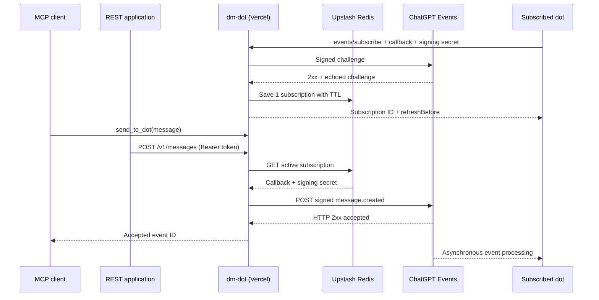

# Architecture

`dm-dot` bridges **MCP tool invocations and authenticated REST requests** to **MCP Events webhook deliveries**. The receiver is ChatGPT, not a separately hosted language model.

The diagram shows *logical participants*; the `events/subscribe` RPC originates from the ChatGPT subscription service on behalf of the dot, and the webhook URL is supplied by ChatGPT.

## Components

| Code | Responsibility |
| --- | --- |
| `api/mcp.go` | Vercel Go Function entry point |
| `api/messages/index.go` | Separate Go Function for the authenticated REST endpoint |
| `pkg/server/server.go` | Authentication, request dispatch, SDK transport, event capability advertising |
| `pkg/server/tools.go` | One registered MCP tool: `send_to_dot` |
| `pkg/server/rest.go` | REST bearer authentication and HTTP request/response validation |
| `pkg/server/message.go` | Shared message validation and signed delivery for both transports |
| `pkg/server/events.go` | `events/list`, `events/subscribe`, `events/unsubscribe` and subscription lifetime |
| `pkg/server/store.go` | Dedicated Upstash Redis REST persistence |
| `pkg/server/webhooks.go` | Callback validation, challenge verification, signing and delivery retries |

## Why a compatibility layer?

The official [`modelcontextprotocol/go-sdk`](https://github.com/modelcontextprotocol/go-sdk) handles Streamable HTTP and MCP protocol negotiation. As of the project's pinned version (`v1.8.0`), its typed server capabilities do not natively expose MCP Events.

To avoid replacing the SDK transport, `pkg/server/server.go` **adds the `events: {}` capability** to its JSON-RPC responses for both legacy `initialize` and MCP 2.0 `server/discover`. The three `events/*` methods are handled alongside the SDK's tool methods at the same authenticated endpoint.

That two-path handshake matters: a plugin can display event definitions while a ChatGPT subscription client still fails to discover them if the server only advertises events via `initialize`.

The regression tests cover **both** discovery paths. Revisit this layer when the upstream SDK gains first-class event support.

## Subscription lifecycle

1. ChatGPT calls `events/list` to discover `message.created`, which has no filters and supports only webhook delivery.
2. ChatGPT calls `events/subscribe` with a callback URL, a Standard Webhooks `whsec_` signing secret, and optionally `ttlMs`.
3. The server validates the request, signs a verification request, and requires the callback to echo the challenge with HTTP `2xx`.
4. The server records a deterministic subscription ID, callback URL, signing secret, and `refreshBefore` in one Redis key with an expiration.
5. ChatGPT refreshes by calling `events/subscribe` again before expiry. `events/unsubscribe` deletes the matching subscription.

`dm-dot` accepts **only one callback** at a time. A different callback cannot take over while a prior non-expired subscription exists. There is no multi-tenant storage, per-sender authorization, or subscription administration UI.

## Message lifecycle and delivery semantics

1. A client calls `send_to_dot` with a nonempty `message` (up to 16 KiB in UTF-8 bytes).
2. The server fetches the subscription; missing/expired subscriptions return an MCP tool error.
3. The server generates an `evt_...` identifier, serializes the event once, signs the exact body and the send timestamp, then posts it to the registered callback.
4. It tries up to three times for transient failures (connection errors, HTTP `429`, or HTTP `5xx`), reusing the **same event ID and body**.
5. A callback HTTP `2xx` yields a tool success with the event ID. Any downstream dot work happens **after** that acknowledgment.

The system is **at-least-once-attempted** for transient failures, but **not guaranteed delivery**: there is no durable outbox or queue, and the function may terminate without replay. Because failures can be ambiguous, retries can produce duplicates. Consumers should treat event IDs as idempotency keys when possible.

### What Redis stores

Only the callback URL, signing secret, subscription ID, and expiration. The application does **not** persist message bodies, previous event IDs, sender identities, processing results, or replies. Redis is not a message queue here.

The stored signing secret is protected by Redis access controls and TLS in transit; **there is no application-level encryption of that field**. This is a trust decision for the single-user deployment model. See [Security](security.md).

## What is explicitly out of scope

- Arbitrary target-dot selection or group delivery
- Two-way agent messaging or result collection
- Stored message history, ordering guarantees, dead-letter queues, or durable retries
- Per-sender API keys, user accounts, quotas, or rate limits
- A permanently running background worker

These are potential future extensions, not hidden capabilities of v1.
